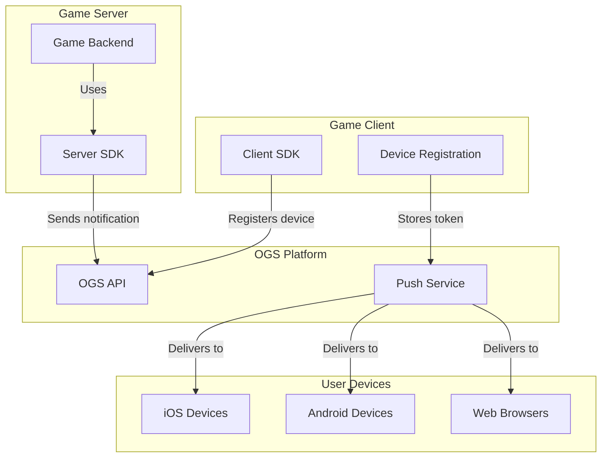

# 📱 Notification Kit

> Add push notifications to your web games in minutes

Notification Kit is a TypeScript library that implements the Push Notification Protocol from the Open Game System (OGS) specification. It enables web games to send push notifications to users across multiple platforms, including iOS, Android, and web browsers.

[](https://www.npmjs.com/package/@open-game-system/notification-kit)
[](https://www.typescriptlang.org/)
[](LICENSE)

## Features

- 🔔 **Cross-Platform Notifications** - Reach users on iOS, Android, and web
- 🔄 **Status Tracking** - Monitor delivery and read status
- 🎯 **Segmentation** - Target specific user groups
- 🧩 **Rich Media** - Support for images and action buttons
- 🔌 **Easy Integration** - Simple API for sending notifications
- 🪄 **React Support** - Ready-to-use React components and hooks

## Overview

Notification Kit streamlines the process of sending push notifications from your game to players, even when they're not actively playing. The library handles:

1. **Sending Notifications**: Easily trigger notifications from your server
2. **Status Tracking**: Monitor when notifications are delivered and read
3. **Device Management**: Register/unregister user devices
4. **User Preferences**: Handle notification opt-in/opt-out

## Architecture

Notification Kit follows the Push Notification Protocol from the OGS specification, providing a client-server architecture:



## Prerequisites

- **Account Linking** - Users should have OGS accounts linked to your game
- **OGS API Key** - Obtain through the [certification process](https://github.com/open-game-system/open-game-system#certification-process)
- **OGS Mobile App** - Required for iOS/Android push notifications

## Quick Start

### 1. Install the package

```bash
npm install @open-game-system/notification-kit
```

### 2. Server-Side Integration

```typescript
import { createNotificationClient } from '@open-game-system/notification-kit/server';

// Create a client with your API key
const notificationClient = createNotificationClient({
  apiKey: 'YOUR_OGS_API_KEY'
});

// Send a notification
async function sendGameInvitation(recipientId, inviterName, gameId) {
  try {
    const result = await notificationClient.sendNotification({
      recipient: {
        gameUserId: recipientId
      },
      notification: {
        type: 'game_invitation',
        title: 'New Game Invitation',
        body: `${inviterName} invited you to play!`,
        data: {
          gameId: gameId,
          inviterId: 'user-123',
          inviterName: inviterName
        },
        deepLink: `opengame://your-game/join/${gameId}`
      }
    });
    
    console.log('Notification sent:', result.id);
    return result;
  } catch (error) {
    console.error('Failed to send notification:', error);
    throw error;
  }
}
```

### 3. Client-Side Integration

```tsx
import { NotificationProvider, useNotifications } from '@open-game-system/notification-kit/react';

// Wrap your app with the provider
function App() {
  return (
    <NotificationProvider>
      <YourGame />
    </NotificationProvider>
  );
}

// Use the hook in your components
function NotificationSettings() {
  const { 
    isPermissionGranted,
    requestPermission,
    registerDevice,
    unregisterDevice,
    deviceId
  } = useNotifications();
  
  const handleToggle = async (enabled) => {
    if (enabled) {
      // Request permission if not granted
      if (!isPermissionGranted) {
        const granted = await requestPermission();
        if (!granted) return;
      }
      
      // Register device
      await registerDevice({
        topics: ['game_invitation', 'turn_notification']
      });
    } else if (deviceId) {
      // Unregister device
      await unregisterDevice();
    }
  };
  
  return (
    <div>
      <h2>Notification Settings</h2>
      <label>
        <input 
          type="checkbox"
          checked={!!deviceId}
          onChange={(e) => handleToggle(e.target.checked)}
        />
        Enable Push Notifications
      </label>
    </div>
  );
}
```

## API Reference

### Server SDK

```typescript
// Create a client for the server
const client = createNotificationClient({ 
  apiKey: string,
  baseUrl?: string 
});

// Client interface
interface NotificationClient {
  // Send a notification to users
  sendNotification(params: SendNotificationParams): Promise<SendNotificationResult>;
  
  // Check notification status
  getNotificationStatus(notificationId: string): Promise<NotificationStatus>;
  
  // Get notification analytics for your game
  getNotificationAnalytics(params?: AnalyticsParams): Promise<NotificationAnalytics>;
}

// Parameters for sending a notification
interface SendNotificationParams {
  // Target recipient
  recipient: {
    // Your game's user ID
    gameUserId: string;
    // or Target a specific device
    deviceId?: string;
    // or Target a topic
    topic?: string;
  };
  
  // Notification content
  notification: {
    // Notification type
    type: string;
    
    // Notification title
    title: string;
    
    // Notification body
    body: string;
    
    // Optional image URL
    imageUrl?: string;
    
    // Custom data to include
    data?: Record<string, any>;
    
    // Deep link URL
    deepLink?: string;
    
    // Actions that user can take
    actions?: Array<{
      id: string;
      title: string;
      deepLink?: string;
    }>;
    
    // When notification should expire
    expiresAt?: string;
  };
}

// Result of sending a notification
interface SendNotificationResult {
  // Notification ID
  id: string;
  
  // Delivery status
  status: 'queued' | 'delivered' | 'failed';
  
  // Timestamp
  timestamp: string;
}

// Notification status details
interface NotificationStatus {
  // Notification ID
  id: string;
  
  // Current status
  status: 'queued' | 'delivered' | 'read' | 'failed';
  
  // When notification was created
  createdAt: string;
  
  // When notification was delivered
  deliveredAt?: string;
  
  // When notification was read
  readAt?: string;
  
  // Error details if failed
  error?: {
    code: string;
    message: string;
  };
}
```

### Client SDK

```typescript
// React hook for notifications
const {
  // Whether permission is granted
  isPermissionGranted: boolean,
  
  // Request permission from user
  requestPermission: () => Promise<boolean>,
  
  // Register this device for notifications
  registerDevice: (params: RegisterDeviceParams) => Promise<RegisterDeviceResult>,
  
  // Unregister this device
  unregisterDevice: () => Promise<boolean>,
  
  // Current device ID (if registered)
  deviceId: string | null,
  
  // Current notification preferences
  preferences: {
    topics: string[]
  },
  
  // Update notification preferences
  updatePreferences: (params: UpdatePreferencesParams) => Promise<boolean>,
  
  // Loading state
  isLoading: boolean,
  
  // Error state
  error: Error | null
} = useNotifications();

// Parameters for registering a device
interface RegisterDeviceParams {
  // Notification topics to subscribe to
  topics?: string[];
}

// Result of registering a device
interface RegisterDeviceResult {
  // Device ID
  deviceId: string;
  
  // Success status
  success: boolean;
}

// Parameters for updating preferences
interface UpdatePreferencesParams {
  // Topics to subscribe to
  topics: string[];
}
```

## Advanced Usage

### Notification Templates

Create reusable notification templates:

```typescript
// Define a template
const templates = {
  gameInvitation: (inviterName, gameId, gameName) => ({
    type: 'game_invitation',
    title: 'New Game Invitation',
    body: `${inviterName} invited you to play ${gameName}!`,
    data: {
      gameId,
      inviterName,
      gameName
    },
    deepLink: `opengame://your-game/join/${gameId}`
  }),
  
  turnNotification: (gameName) => ({
    type: 'turn_notification',
    title: 'Your Turn',
    body: `It's your turn in ${gameName}!`,
    data: {
      gameName
    }
  })
};

// Use the template
await notificationClient.sendNotification({
  recipient: { gameUserId: 'user-123' },
  notification: templates.gameInvitation('Alice', 'game-456', 'Chess')
});
```

### Batch Notifications

Send notifications to multiple users:

```typescript
async function sendBatchNotifications(userIds, notification) {
  const results = await Promise.allSettled(
    userIds.map(userId => 
      notificationClient.sendNotification({
        recipient: { gameUserId: userId },
        notification
      })
    )
  );
  
  return {
    sent: results.filter(r => r.status === 'fulfilled').length,
    failed: results.filter(r => r.status === 'rejected').length,
    results
  };
}
```

### Custom Notification Components

Build custom components:

```tsx
import { useNotifications } from '@open-game-system/notification-kit/react';

function CustomNotificationToggle() {
  const { deviceId, registerDevice, unregisterDevice, isLoading } = useNotifications();
  
  return (
    <button 
      className="notification-button"
      disabled={isLoading}
      onClick={async () => {
        if (deviceId) {
          await unregisterDevice();
        } else {
          await registerDevice({
            topics: ['game_invitation', 'game_updates']
          });
        }
      }}
    >
      {isLoading ? 'Loading...' : deviceId 
        ? 'Disable Notifications' 
        : 'Enable Notifications'
      }
    </button>
  );
}
```

## Debugging

### Server-Side Debugging

Monitor notification status and troubleshoot delivery issues:

```typescript
// Get the status of a notification
const status = await notificationClient.getNotificationStatus('notification-123');
console.log('Notification status:', status);

// Enable debug mode
const notificationClient = createNotificationClient({
  apiKey: 'YOUR_API_KEY',
  debug: true
});

// Debug logs will be output to console
```

### Client-Side Debugging

Enable debug mode in the provider:

```tsx
<NotificationProvider debug={true}>
  <YourApp />
</NotificationProvider>
```

## Best Practices

### 1. Notification Content

- Keep titles under 50 characters
- Keep bodies under 150 characters
- Include clear call-to-action
- Personalize when possible
- Use rich media sparingly (affects delivery speed)

### 2. Timing and Frequency

- Respect user time zones
- Avoid sending multiple notifications in short periods
- Use `expiresAt` for time-sensitive notifications

### 3. User Experience

- Always make notifications opt-in
- Provide clear settings controls
- Explain the value of notifications
- Respect user preferences
- Group related notifications when possible

## Troubleshooting

### Common Issues

#### Permission Denied

If users deny notification permission:

```typescript
const { isPermissionGranted, requestPermission } = useNotifications();

// Check if permission was previously denied
if (!isPermissionGranted) {
  // Show explanation about notification benefits
  showNotificationExplanation();
  
  // Then request permission
  const granted = await requestPermission();
  if (granted) {
    // Permission granted, register device
  } else {
    // Permission denied, show instructions on how to enable manually
  }
}
```

#### Notification Not Delivered

Check notification status:

```typescript
const status = await notificationClient.getNotificationStatus(notificationId);

if (status.status === 'failed') {
  console.error('Delivery failed:', status.error);
  // Handle the specific error
}
```

## Support and Community

- GitHub Issues: [https://github.com/open-game-system/notification-kit/issues](https://github.com/open-game-system/notification-kit/issues)
- Discord Community: [Join our Discord](https://discord.gg/n8TWakM7k8)
- Email Support: [hello@opengame.org](mailto:hello@opengame.org)

## License

Notification Kit is licensed under the MIT License - see the [LICENSE](LICENSE) file for details.

---

Built with ❤️ by the [Open Game Collective](https://opengame.org/collective) 
