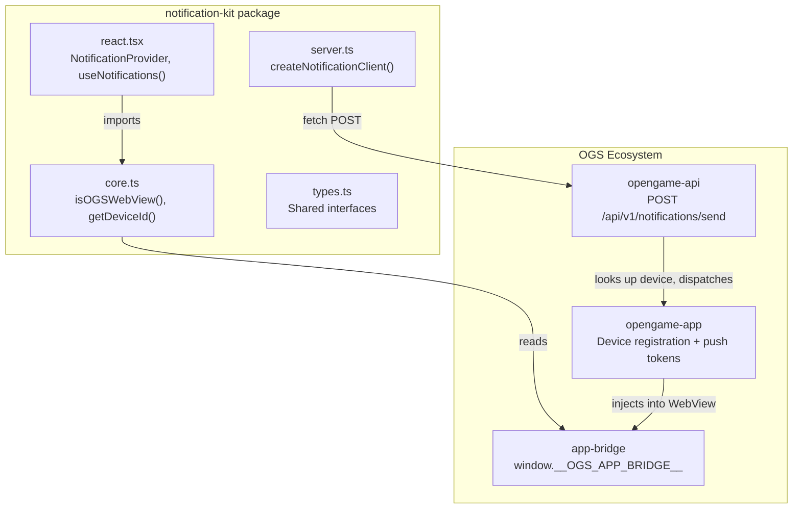
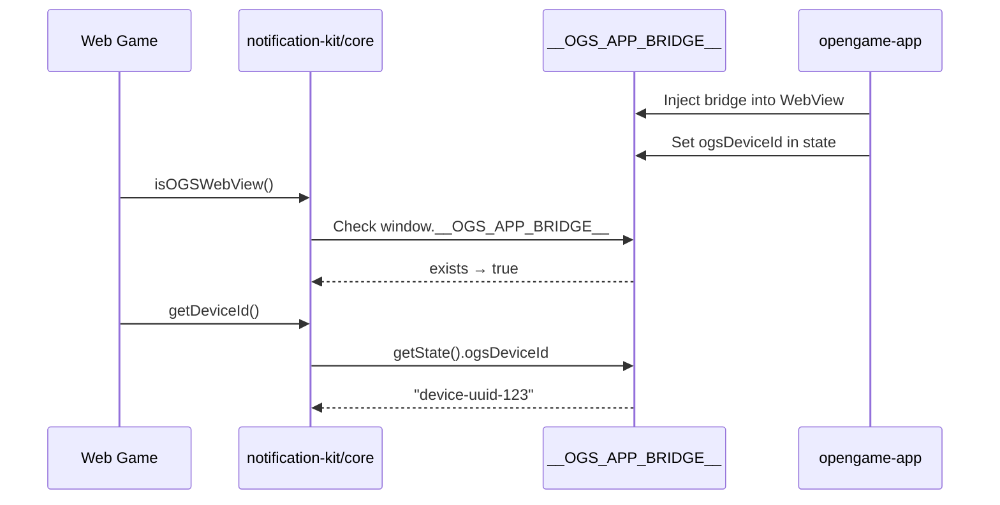
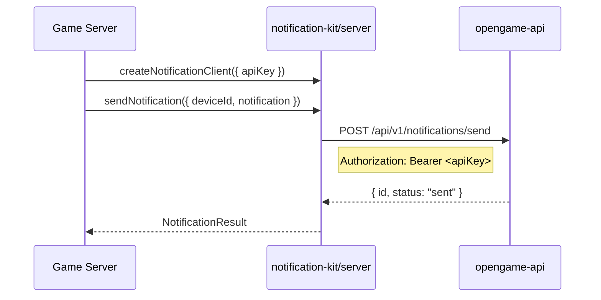

# Notification Kit — Architecture

## System Map

Notification Kit is a TypeScript SDK that sits between web games and the OGS platform, providing push notification capabilities in three layers:



## Module Boundaries

| Module | File | Responsibility | Dependencies |
|--------|------|---------------|--------------|
| Core | `src/core.ts` | Detect OGS WebView, read device ID from app-bridge, subscribe to changes | None (reads `window.__OGS_APP_BRIDGE__`) |
| React | `src/react.tsx` | React context provider that manages device ID state and exposes `useNotifications()` hook | Core, React (peer) |
| Server | `src/server.ts` | HTTP client factory for sending push notifications via the OGS API | Types (fetch is global) |
| Types | `src/types.ts` | Shared TypeScript interfaces for notification payloads, results, errors | None |
| Index | `src/index.ts` | Barrel export for core functions + config type | Core, Types |

## Build Output

tsup produces dual-format output for each entry point:

```
dist/
├── index.js      (ESM)    ├── index.cjs     (CJS)    ├── index.d.ts    (types)
├── react.js      (ESM)    ├── react.cjs     (CJS)    ├── react.d.ts    (types)
├── server.js     (ESM)    ├── server.cjs    (CJS)    ├── server.d.ts   (types)
```

## Communication Flow

### Client-Side (Web Game → App Bridge)



### Server-Side (Game Server → OGS API)



## Key Design Decisions

1. **Three separate entry points** — consumers import only what they need. A game server never loads React; a web game never loads the server client.

2. **Zero runtime dependencies** — the SDK uses only platform globals (`window`, `fetch`) and optional React peer dep.

3. **App-bridge as identity layer** — rather than implementing its own device registration, the SDK reads the device ID that `opengame-app` already injected via `app-bridge`. This keeps the notification SDK thin.

4. **Bulk send is client-side fan-out** — `sendBulkNotifications` uses `Promise.allSettled` over individual requests. This is intentional for alpha; a true batch endpoint can be added to `opengame-api` later.
